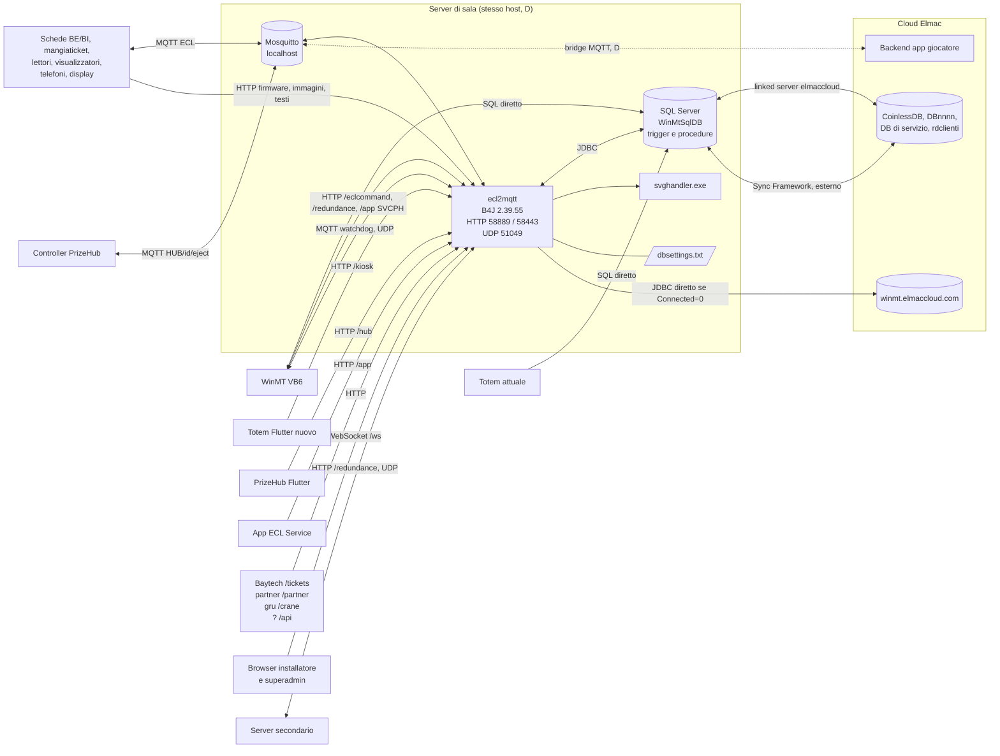

# Galileo HQ — ecl2mqtt 00: mappa del motore di sala `ecl2mqtt` (già `ecs2mqtt`)

**Stato:** bozza · **Responsabile:** Piero · **Aggiornato:** 2026-10-25

**Fonte:** sorgente B4J del motore di sala, versione 2.39.55 (`legacy/ecl2mqtt/`, escluso dal repository); documentazione di Fabrizio in `docs/fonti/ecl2mqtt/` · **Collegati:** `ecl2mqtt-01` … `ecl2mqtt-07` (analisi per zona), `docs/winmt/winmt-00-mappa.md`, `docs/db/db-08-dizionario-dati.md`, `sql/codice-db/`

Il motore di sala è il secondo programma che scrive nel database di sala, accanto a WinMT. Questo documento ne dà la mappa e risponde a tre domande:
1. quanto è separato da WinMT e dove ci sono doppioni (§ 3);
2. con chi parla e come, per collocarlo nell'ecosistema (§ 4);
3. cosa aggiunge al modello dati (§ 5).

Il dettaglio, con le evidenze `file:riga`, è nei sette documenti di zona.

Convenzioni: **[verificato]** = ricontrollato sul sorgente durante la stesura di questa sintesi. Gli altri punti vengono dai documenti di zona, dove ciascuno è marcato **V** (verificato nel codice) o **D** (dedotto). Le credenziali non sono mai riportate.

---

## 1. Il progetto

| Voce | Valore |
|------|--------|
| Progetto | `ecs2mqtt.b4j`, pacchetto `ElmacECL.mqttbridge`, versione **2.39.55** (`ecs2mqtt.b4j:133`) |
| Nome | **`ecl2mqtt`** è il nome attuale del servizio. **`ecs2mqtt`** era il nome della prima versione ed è deprecato, ma resta nel nome del file di progetto (`ecs2mqtt.b4j`), nella cartella di installazione (`C:\ecs2mqtt\`), nella chiave `setup2.ecs2mqttVer` e in un comando di riavvio (§ 4.3). `elc2mqtt` era solo un nome di cartella sbagliato, ora corretto (conferma di Fabrizio, 25/10) |
| Tecnologia | B4J 10.2 (Basic4Java, Anywhere Software), applicazione Java senza interfaccia. Librerie: jServer (HTTP e WebSocket), jMQTT, jSQL con driver Microsoft JDBC 6.4, SQLCallProc, jOkHttpUtils2, jNetwork (UDP), jShell (processi esterni) |
| Dimensioni | 88 moduli `.bas` (50.666 righe), più il modulo `Main` dentro il `.b4j` (4.713 righe). Il modulo più grande è `DBwinmt.bas` (15.954 righe, 222 Sub). 37 pagine HTML del backoffice in `Objects/www/` |
| Installazione | `C:\ecs2mqtt\`, avviato come servizio con NSSM. Configurazione in `C:\ecs2mqtt\dbsettings.txt` |
| Porte | HTTP **58889**, HTTPS **58443**, UDP **51049** (autodiscover), MQTT su `localhost` (porta predefinita) |
| Dipendenze | Senza database non parte: dopo 15 tentativi di connessione termina (`ecs2mqtt.b4j:439-451`) |

Nella cartella `Files/` del sorgente ci sono un certificato, la sua **chiave privata** e un keystore. La cartella `legacy/` è esclusa da git, ma questi file vanno trattati come segreti.

### Cosa fa, in una riga per ruolo

Il motore riunisce in un solo processo cinque ruoli che nel nuovo sistema potrebbero separarsi:

| Ruolo | Contenuto | Zona |
|---|---|---|
| **Gateway dei dispositivi** | Protocollo ECL su MQTT con le schede BE/BI, mangiaticket, lettori, visualizzatori; registrazione dei record di gioco; distribuzione di orario, blacklist e happy hour | 01, 04 |
| **Provisioning e manutenzione** | Scoperta, assegnazione e programmazione delle schede; firmware OTA; schermate generate da template SVG; test mode, swap BI, Armageddon | 06, 04 |
| **Logica di business** | Saldi, ricariche, bonus, clienti, livelli e promozioni, premi, PrizeHub, gru, redeem | 02, 03, 05 |
| **API per i client** | REST per totem, PrizeHub, app di servizio, partner, Baytech, gru; API "cloud" via MQTT per l'app del giocatore | 05 |
| **Backoffice di sala** | Web app per installatori e superadmin (dashboard, macchine, firmware, schermate, lingue, configurazione) | 06 |

---

## 2. Suddivisione per l'analisi

Il codice è stato diviso in sei zone tecniche, più una per la documentazione esistente. I flussi hanno l'identificativo `Ezz-nn` e il peso S/M/L di Analisi 01 § 1.

| Doc | Zona | Moduli principali | Flussi | S | M | L |
|-----|------|-------------------|------:|--:|--:|--:|
| [ecl2mqtt 01](ecl2mqtt-01-nucleo-mqtt.md) | Nucleo, MQTT e protocollo ECL | `Main`, `mqttMessages`, `ecl_cmds`, `eclcommand`, `eclservice`, `Autodiscover`, `sicurezza` | 35 | 10 | 16 | 9 |
| [ecl2mqtt 02](ecl2mqtt-02-db-winmt-1.md) | Accesso al DB di WinMT, parte 1 | `DBwinmt` righe 1–7716 | 32 | 6 | 18 | 8 |
| [ecl2mqtt 03](ecl2mqtt-03-db-winmt-2.md) | Accesso al DB di WinMT, parte 2 | `DBwinmt` righe 7717–15954 | 36 | 13 | 15 | 8 |
| [ecl2mqtt 04](ecl2mqtt-04-coinless-gru-config.md) | DB coinless ed ECL, gru, configurazione | `DBcoinless`, `DBCrane`, `DbConfig`, `syncConfig` | 37 + 1 morto | 11 | 17 | 9 |
| [ecl2mqtt 05](ecl2mqtt-05-api-rest.md) | API REST | `FlutterKioskHandler`, `FlutterTicketsHandler`, `App*Handler`, `APIHandler`, `PartnerHandler`, `CraneHandler`, `cliente`, `clsElmacAPI` | 54 | 24 | 21 | 9 |
| [ecl2mqtt 06](ecl2mqtt-06-backoffice-provisioning.md) | Backoffice, installazione, firmware, schermate | `Macchine*`, `InstallazioneNuovaMacchina`, `deviceprogrammer`, `biprogrammer`, `ScreenBuilder`, `GrigliaIO` | 46 | 19 | 15 | 12 |
| [ecl2mqtt 07](ecl2mqtt-07-documentazione-esistente.md) | Documentazione esistente in `docs/fonti/ecl2mqtt/` | — | — | | | |
| | **Totale** | | **240** | **83** | **102** | **55** |

> **Attenzione.** I 240 flussi sono contati **per zona tecnica** e non sono ancora deduplicati. Lo stesso flusso compare in più zone: la cassa mobile, per esempio, è in ecl2mqtt 01 e ecl2mqtt 02. Molti flussi sono inoltre doppioni di flussi WinMT già contati in Analisi 01. Il lavoro fatto per WinMT (ricondurre i flussi alle zone concettuali, contare una volta sola e marcare duplicati, esterni e morti) va ancora fatto, e prima di allora i numeri non vanno usati per la stima.

---

## 3. Separazione da WinMT

### 3.1 La risposta in breve

**I due programmi non sono separati per responsabilità.** Il punto d'integrazione è il database di sala, che entrambi leggono e scrivono, spesso sulle stesse tabelle e ciascuno con le proprie regole. A grandi linee, nelle tabelle di flusso delle zone:
- circa **4 flussi su 10** sono marcati come doppione di una regola WinMT;
- circa 3 su 10 sono complementari (uno scrive, l'altro legge);
- circa 3 su 10 esistono solo nel motore.

È un conteggio grezzo sulla colonna "rapporto con WinMT", non ancora deduplicato.

Le regole vivono in **tre posti**: le form di WinMT, il motore B4J e il codice del database (trigger `decodifica_flusso`, procedure `decodifica_record`, `scriviTicketsAutomatici`, `sp_redeem_*`, `sp_crane_*`). È il contrario del principio "logica una sola volta, lato server".

Secondo la documentazione di Fabrizio (ecl2mqtt 07 § 2.1), i doppioni sono in gran parte **voluti**. Per servire il nuovo totem Flutter si è fatto un porting a pezzi delle classi VB6 nel motore: anti-clonazione, VIP, promozioni Gold, ricarica, log POS e contanti, redeem, ripartizione su più card. In diversi punti il porting ha **corretto o cambiato** la regola, per esempio l'unità della soglia VIP o la card "non aggiornata" che non conta più come clonata. Così la cassa (WinMT) e il totem (motore) applicano oggi regole diverse allo stesso cliente.

L'unica separazione decisa in modo esplicito è l'**"Opzione A" del PrizeHub** (10/07/2026): WinMT non scrive più sugli slot e passa dalle API REST del motore. La decisione è applicata (WinMT 07).

### 3.2 I canali diretti tra i due programmi

Oltre al database condiviso, WinMT e il motore si parlano così (ecl2mqtt 01 § 3.f):

| Canale | Direzione | Uso |
|---|---|---|
| `Setup` (riga 101) e `setup2` | WinMT → motore | Configurazione ECL (`AdmPass`), ticketless (`F9/F10`), multisala (`T6`), scala bonus (`T10/T12`). Letti in gran parte una volta sola all'avvio |
| `EcsMacchine.F0` | WinMT → motore | "Configurazione da inviare": il motore riprogramma la scheda al boot e azzera il flag |
| HTTP `/eclcommand` | WinMT → motore | Comandi alle macchine (adozione, programmazione, fuori servizio, blacklist, pagine). **Senza autenticazione** |
| HTTP `/redundance/setprimary` | WinMT → motore | Failover sul server secondario |
| HTTP `/app/action/SVCPH*` | WinMT → motore | Carico e calibrazione degli slot PrizeHub (Opzione A) |
| UDP 51049 | WinMT → motore | Autodiscover del server (`ARQFIND`), versione (`VERSION`), failover (`SLAVEFIND`) |
| MQTT | WinMT ↔ motore | Watchdog ogni 30 s. Il `watchdog/restart` che WinMT pubblica **non ha ascoltatori** nel motore |
| `setup2.ecs2mqttVer`, `AuditLog` | motore → WinMT | Versione del motore (la chiave conserva il nome vecchio; WinMT ne deduce il topic del watchdog); eventi sui dispositivi |

### 3.3 I doppioni, per tema

Ricondotti alle zone concettuali di Analisi 00. "B4J" indica il numero di implementazioni nel motore.

| Tema | WinMT | B4J | Differenze principali | Doc |
|---|---|---|---|---|
| **Saldo crediti e bonus del cliente** | W02-07 (winmt-04 § 4.3) | 3 formule | Nessuna delle tre coincide con WinMT: non filtrano `WinMt = 1`, non sottraggono il canone VIP (`NImp` 18), una ignora i tipi 8, 9, 10, 11, 15, 16. Una variante restituisce il saldo dichiarato dalla card stessa | 02 § 5.1, 03 § 5.5 |
| **Saldo e consumo dei punti** | W02-16, W01-06 (`TogliPunti`) | 3 formule di saldo, 2 di consumo | Il motore non spende i lotti con `Tickets.NonCont = 1`, WinMT sì; niente variante Golden; `OperOut` sempre 0 | 03 § 5.1-5.2 |
| **Movimenti di ricarica e bonus su `TransCard`** | W02-06, W05-02 (`AddTransCard`) | 4 | Cambiano da un'implementazione all'altra: `NImp`, `T0`, `F0`, `CodMac`, `ValoreCassa`, `N0` e l'aggiornamento di `Clienti.Credito`. Gli accrediti da cloud, redeem e `create-user` vanno come `NImp 0`, cioè **incasso di cassa fissa**. Solo `RicaricaCardTotem` è un porting fedele, e in più ha transazione e idempotenza | 01 § 5.1, 02 § 5.5, 04 § 5.1, 05 § 5.11 |
| **Bonus a scaglioni sulla ricarica** | W02-18 (`CalcBonus`, `ECL_BonusHandler`) | 3 | Il cloud non dà ticket bonus; sul totem il bonus crediti lo decide il client e il server non lo ricontrolla | 05 § 5.1 |
| **Ticket automatici per partita** | W08-14 (trigger e procedura) | 1 + la procedura | La procedura `scriviTicketsAutomatici` (chiamata da `decodifica_record`) e `DBwinmt.BonusTickets` (chiamata da `CanPlay`, solo in modalità online) applicano regole diverse. Se per la stessa partita girano entrambe, i ticket sono accreditati **due volte** [D: da verificare in produzione] | 02 § 5.3 |
| **Addebito della partita** | W04-26 (procedura del DB) | 1 | In modalità card addebita la procedura `decodifica_record`, in modalità online il motore (`CanPlay`). Il parametro di priorità bonus/crediti sta in posti diversi | 01 § 5.4 |
| **Decodifica del record della scheda** | procedura `decodifica_record` | 1 | Il motore e la procedura non concordano sulla posizione dei byte del bonus (35–36 contro 36–37) né sull'UID del tipo 8 | 04 § 4.6, § 5.2 |
| **Anti-clonazione e blacklist** | W04-04, W02-08, W01-14 | 2 | Il motore fa lo stesso confronto ma **non mette mai in blacklist**. La blacklist inviata alle schede contiene al più 21 card e include anche card già sbloccate | 05 § 5.3, 02 § 5.13 |
| **Creazione del cliente** | W02-09, W03-07 | 2 | Il motore non salta gli `IdContatto` già presenti in `TransCard` (un cliente nuovo può ereditare movimenti orfani), scrive `Clienti.N0 = 2` e non applica la promozione nella creazione da app | 03 § 5.6, 05 § 5.2 |
| **Livelli, VIP, promozioni, compleanni** | W03-18, W03-20, W03-23, W04-23 | 1 | Soglia VIP in un'altra unità, promozione automatica, nuova regola BIRTHDAY → SILVER, canone VIP non implementato. Il motore usa il livello 4 per il compleanno, db-08 il 3 | 03 § 5.7, 05 § 5.4-5.5 |
| **Ripartizione su più card** | W03-24 | 1 | La modalità `BonusTotale` è cambiata il 21/10/2026; i ticket per card si calcolano con `ceil` | 05 § 5.6 |
| **Consegna premi e vincite** | W01-06, W02-15 | 3 canali (`/app`, `/hub`, `/tickets`, più `/partner`) | Il motore scrive una riga di `Vincite` per richiesta, WinMT una per pezzo. Nel prelievo multisala l'esito di `sp_last_trans` è ignorato. Non c'è transazione (salvo PrizeHub), e su `/tickets` il controllo del saldo è commentato. Esistono **due modelli di giacenza** (scarico al ritiro contro scarico al carico dello slot) | 03 § 5.3-5.4, 05 § 5.7 |
| **Redeem dei codici QR** | W04-19 | 1 | Stessa sequenza, ma contratto delle procedure incompatibile: WinMT usa le versioni con parametri OUTPUT e **le riscrive a ogni avvio** (WinMT 00 § 6.5), il motore usa le versioni "B4X" a resultset, presenti nel DB di test [verificato] | 03 § 5.8, 05 § 5.8 |
| **Configurazione delle macchine** | W08-03, -04, -05, -06, -12 | 1–3 | Formula diversa per l'ingresso E-coin (`ValIn9`). I costi per livello cambiati dal backoffice arrivano alla scheda solo alla programmazione successiva. Le macchine nuove nascono con `F0 = 0` (in WinMT con 1). Il catalogo dei modelli si scrive nel **DB di servizio cloud**, non in sala | 06 § 5 |
| **Login e ruoli degli operatori** | W10-06, W10-07 | 3 | Il motore riconosce il superadmin da `Operatori.Id = 0`, WinMT da `Livello And 3`. Il login con password ammette qualunque operatore, anche non attivo: il controllo è commentato [verificato `DBwinmt.bas:6128`] | 01 E01-32, 06 § 5.1 |
| **Postazione e operatori virtuali** | W02-02, W10-02 | 1 | Il motore si registra in `Setup` come `PRIZEHUB01\|` con `IDPost = MAX+1` e crea operatori con Id da 1001, lo stesso intervallo dei `TotemPrizes` di WinMT | 01 § 5.7, 02 § 5.8 |
| **Regola multisala (`IdLong` o `IdContatto`)** | `Setup.T6` con `#` = disattivato | 3 regole, più `fn_idcliente` | In multisala alcune letture e scritture usano la chiave sbagliata: rimborso ticket, cassa mobile, saldo letto per la scheda | 01 § 5.3, 02 § 5.1, 03 § 6 |
| **Migrazione dello schema all'avvio** | W02-01, W04-25 | 1 | Entrambi modificano lo schema all'avvio. Il motore crea tabelle (`ecl_log`, `BEConfig`, `coinless_sbuilder_*`) e ricrea la vista `vs_CoinlessSpecialTimes`, ma **non crea procedure**. Le versioni "B4X" delle `sp_redeem_*` sono state installate a parte: l'ipotesi di WinMT 00 § 6.5 è confermata a metà | 02 § 4c, 03 § 4c, 06 § 4.c |
| **Log del totem (contanti e POS)** | W04-05, W04-06 | 1 | Convivono due canali: il totem attuale scrive direttamente nel DB, quello nuovo passa da `/kiosk`. Il recupero delle sequenze `Pending` di WinMT può riaccreditare una ricarica già fatta [D]. Manca lo scassettamento del totem | 05 § 5.10, § 6.15 |

### 3.4 Dove la divisione funziona

| Tema | Chi scrive | Chi legge o comanda |
|---|---|---|
| Telemetria e contatori | Schede → motore → trigger del DB (`CoinlessDati` → `EcsDati`, `TransCard`) | WinMT (incassi, report) |
| Happy hour | WinMT (configurazione, W04-17) | Motore (applicazione alle schede, ogni 40 s) |
| Provisioning, firmware, schermate | Solo motore | WinMT comanda via `/eclcommand` |
| Gru: carichi, scarichi, vincite | Solo motore (`DBCrane`) | WinMT (stato e valore medio, W07-11) |
| Slot PrizeHub | Solo motore (Opzione A) | WinMT via API |
| Blacklist | WinMT (blocco) | Motore (distribuzione alle schede) |
| Eliminazione e disinstallazione macchine | Solo WinMT | — |

### 3.5 Cosa esiste solo nel motore

Gestione delle schede (scoperta, assegnazione, programmazione, OTA di BE e BI, swap BI, test mode), schermate e lingue delle schede, Armageddon, ridondanza master/slave, cassa mobile, rimborso partita con card operatore, API per totem, PrizeHub, partner, Baytech e gru, API dell'app del giocatore via MQTT.

---

## 4. L'ecosistema

### 4.1 Mappa

### 4.2 Gli interlocutori

| Interlocutore | Canale | Cosa scambia | Autenticazione | Doc |
|---|---|---|---|---|
| **Schede BE con la BI** (giochi, firmware 131) | MQTT (`send_client`, `ElmacECL/…`, `SetUp/…`, `Service/…`, `StateBE/…`, `ElmacStatusBI/…`); HTTP `/eclservices` per firmware, immagini e testi | Record di gioco, stato, annunci, provisioning; comandi, configurazione, orario, blacklist, happy hour | Utente del broker unico per tutti (credenziale nel codice). HMAC sui record verificato dal trigger SQL; su HTTP il dispositivo si riconosce dall'IP | 01 § 3.a, 06 § 3 |
| **Altri dispositivi** (mangiaticket 123/133, lettori cassa/totem 132, visualizzatori 136, telefoni 900, display Astoria 311) | MQTT, provisioning dei file | Stato, configurazione compatta, ticket nel buffer | come sopra | 06 § 4.e |
| **Controller fisico PrizeHub** | MQTT `HUB/<id>/eject` (uscita) | Erogazione | broker | 05 § 3a |
| **WinMT** | DB, HTTP, UDP, MQTT | § 3.2 | nessuna su `/eclcommand` e `/redundance` | 01 § 3.f |
| **Totem Flutter nuovo** | HTTP `/kiosk/*`, `/eclservices/getkioskconfig`, `getscalettabonus` | Card, ricariche, bonus, log contanti e POS, redeem, storico | Token bearer; config e scala bonus senza autenticazione | 05 |
| **Totem attuale** | SQL diretto | `TransCard`, `LogTransazioniTotem`, `LogTransazioniPos` | utente del DB | 05 § 3c |
| **App PrizeHub Flutter** | HTTP `/hub/*` | Lettura card, catalogo, riscatto | Token bearer | 05 |
| **App "ECL Service"** (operatori, Android) | HTTP `/app/*` | Blocco card, rimborsi, fuori servizio, reboot, swap BI, gestione slot PrizeHub | Token bearer; l'operatore è dichiarato dal client | 05 |
| **Baytech** (vecchio PrizeHub), **partner**, **gru**, **`/api`** | HTTP | Premi e ticket; magazzino gru; provisioning card | Token bearer, salvo `/api`, che **non verifica il token** [verificato] | 05 |
| **Browser** (installatori, superadmin) | WebSocket `/ws/*` | Backoffice | Sessione, ma il controllo non blocca la pagina e gli eventi non lo ripetono | 06 § 6 |
| **Server secondario** | HTTP `/redundance/*`, UDP `SLAVEFIND` | Stato primario, failover | Nessuna. La risposta a `SLAVEFIND` contiene la password dell'amministratore WinMT, offuscata in modo reversibile [verificato `Autodiscover.bas:249-256`] | 01 § 3.e |
| **Cloud Elmac, via SQL** | Linked server `[elmaccloud]` dal SQL Server di sala, oppure JDBC diretto a `winmt.elmaccloud.com` (`Connected = 0`) | Multisala (`sp_last_trans`, `sp_preleva_punti`, ticket di altre sale); replica di firmware, immagini e lingue; ricerca nella flotta e configurazioni di default all'installazione; **scrittura** del catalogo modelli nel DB di servizio del cliente | Utenti SQL con credenziali nel codice | 04 § 3c, 06 § 3.c |
| **Cloud Elmac, via MQTT** | `ElmacAPI/<metodo>` in ingresso, `ElmacAPIResponse/<metodo>`, `Errors/<Nimp>/<livello>`, `ElmacECL/Server/…` in uscita | API dell'app del giocatore (utenti, saldo, ricarica, movimenti); errori; stato delle macchine | Solo l'accesso al broker. Il motore pubblica sul broker locale: le risposte arrivano al cloud solo se il broker è in **bridge**, configurazione che non è nel repository [D] | 01 § 3.a, 05 § 3a |
| **Processi locali** | `svghandler.exe` (rendering delle schermate), `ping`, `nssm` / `net stop` | | | 06 § 3.c |

### 4.3 Osservazioni sull'architettura

1. **Un solo broker.** I "due broker" (main e setup) sono due connessioni allo stesso mosquitto locale. La separazione è solo per spazio di topic (`ElmacECL/…` contro `SetUp/…`), e il codice stesso la attraversa.
2. **Verso il cloud ci sono quattro canali indipendenti:**
   - Sync Framework, esterno al motore;
   - il linked server, anche in scrittura;
   - la connessione JDBC diretta;
   - il bridge MQTT, presunto.

   Il motore non usa le tabelle `scope_*`, ma le tabelle che scrive (`ecl_*`, `BEConfig`, `Gru*`, `coinless_sbuilder_*`) sono sincronizzate in produzione.
3. **Esiste già un modello cloud, che HQ deve conoscere.** In `CoinlessDB` ci sono `CoinlessImpianti`, `vs_definizione_nome_macchina`, `CoinlessDefaultTypeConfig`, `sp_CoinlessMacchine`, `sp_ConfigurazioneMacchina` e `sp_DettaglioIngressiMacchina`. I DB di servizio per cliente contengono `Type`, `Manuf` e `Machines`; `rdclienti` (o `DbClientiMultilocale`) contiene le procedure multisala. Di questi oggetti è analizzato finora solo il DB clienti di gruppo, nella sua versione di test `CliTest` (DB 09). Lì si vede anche che il motore usa `rdclienti` fisso per `sp_preleva_punti`.
4. **Autonomia della sala.** Il gioco funziona senza cloud, ma l'installazione di una macchina dal backoffice (ricerca nella flotta, wizard dei modelli) **richiede il cloud**. Il motore stesso si ferma se il DB di sala non risponde.
5. **Stato in memoria.** Quali schede sono online, in setup o pronte, le code di programmazione e l'"install mode" vivono in memoria e si perdono al riavvio. Si ricostruiscono dagli annunci delle schede e dal flag `F0`. In più, dopo una caduta del broker le sottoscrizioni non vengono rifatte: il servizio resta connesso ma non riceve più nulla (ecl2mqtt 01 § 0.4).
6. **Sicurezza.** È un tema trasversale, ed è uno dei motivi per non portare il codice così com'è:
   - endpoint senza autenticazione con effetti distruttivi: `/api` `purge-card`, `/config`, `/redundance`, `/eclcommand` `restartservice`;
   - token interscambiabili tra gli handler [verificato `sicurezza.bas:112`: la chiave per handler è calcolata e non usata];
   - password e token dei clienti nelle risposte API;
   - SQL composto con dati presi da MQTT e da HTTP;
   - credenziali nel codice.
7. **Riavvio remoto col nome vecchio.** Il comando `/eclcommand?command=restartservice` ferma il servizio con `nssm stop ecs2mqtt` (`funzioni.bas:155`). Il servizio attuale si chiama `ecl2mqtt`, quindi il riavvio remoto probabilmente non trova il servizio [D]. L'altra routine di riavvio, che usa `ecl2mqtt` (`ecs2mqtt.b4j:3960-3972`), non è chiamata da nessuno.

---

## 5. Cosa aggiunge al modello dati

### 5.1 Tabelle che solo il motore usa

Nessuna di queste è in db-08. Il significato delle colonne è ricostruito in ecl2mqtt 04 § 4.3 e ecl2mqtt 03 § 4b.

| Gruppo | Tabelle | Contenuto |
|---|---|---|
| Telemetria grezza | `CoinlessDati`, `CoinlessDecodedData`, `CoinlessDataBuffer` | Record della scheda con HMAC; snapshot dei contatori decodificato; ticket vinti non ancora accreditati, per card |
| Schede e firmware | `ecl_SchedeFirmware`, `ecl_firmware`, `BEConfig`, `EcsModuli` (nuovi usi) | Anagrafica delle schede fisiche e versioni; binari; stato tecnico e configurazione della BI in JSON |
| Provisioning | `ecl_Provisioning`, `ecl_DeviceProvisioning`, `Coinless_sbuilder_page_provisioning` | Cosa è già stato consegnato a ciascuna scheda |
| Schermate e testi | `CoinlessImages` (anche i firmware della BI, `.srec`), `CoinlessLanguages`, `coinless_sbuilder_pages`, `coinless_sbuilder_templates_svg` | Contenuti per i display delle schede |
| Log | `ecl_log` (circa **25.000 righe al giorno** in produzione, nessuna pulizia), `debug_log` | Log di ogni messaggio MQTT, test mode, Armageddon |
| Gru | `GruMagazzinoDettaglio`, `GruMovimenti`, `CraneCounterSyncLog` | Scritte solo dal motore. Precisano db-08 |
| PrizeHub | `PrizeHubSlots`, articoli fittizi `SPINDLE…` in `Premi` | Slot, quantità, ticket medi |

### 5.2 Colonne il cui significato cambia rispetto a db-08

Le più rilevanti; l'elenco completo è nel § 4 di ogni zona.

| Colonna | Nel motore | Rispetto a db-08 |
|---|---|---|
| `EcsMacchine.T0` | JSON di stato `{valorepiatto, statoBI, errBI, BISwap, BISwapStep, NoRec}`. Con `NoRec` o `BISwap` attivi i record di gioco sono scartati | **contraddice** (valore del piatto) |
| `EcsMacchine.CntrLet9`, `CntrLet16`, `ValIn3/4` | La stessa grandezza (impulsi per tick di gettoniera e banconote) letta da colonne diverse; `CntrLet9` è anche "tipo erogatore 2" | **contraddice**; `CntrLet16` non è in db-08 |
| `EcsModuli.ShortAd`, `T0`, `NImp` | Codice del dispositivo (non l'IP); JSON con l'IP; flag "riprogrammabile" (non la sala) | **contraddice** |
| `TransCard.NImp` | 0 anche per accrediti da cloud, redeem e totem; 12 = partita gratuita da card operatore, scritta dal motore; 15 = "bonus trasferiti" | integra e contraddice |
| `TransCard.T0`, `F0`, `CodMac`, `ValoreCassa`, `N0` | `T0` senza zeri o NULL; `F0` sempre 0; `CodMac` = `CASSA-MOBILE`, `ECL-SERVICE`, `CLOUD`, `kioskId` o codice macchina; `ValoreCassa` valorizzato anche per i bonus; `N0` in due convenzioni | **contraddice** in più punti |
| `Tickets.MangiaT`, `NonCont`, `NumTrans`, `F1/T1`, `NRep`, `Oper` | `MangiaT` 1, 64, 8256 con significati propri; `NonCont` esclude dal saldo spendibile; `NumTrans` calcolato con un'altra formula; `NRep 8` e `Oper 10000` come marcatori del motore | integra e contraddice |
| `Clienti.UserName`, `Password`, `Abilita`, `N0`, `Foto`, `IdContatto` | Token UUID dell'app; PIN in chiaro; `Abilita` con quattro significati; `N0 = 2` dalla creazione via API (spiega il "2" di db-08); chiave `CardCreatedBy` in `Foto` | nuovi significati |
| Livello della card | 4 = compleanno | db-08: 3 |
| `Vincite` | Una riga per richiesta, `N_Tickets` = totale; `Cons = 1` sempre; `N0` mai scritto | **contraddice** (una riga per pezzo) |
| `LogTransazioniTotem.AC`, `CAut`, `TCC`; `LogTransazioniPos.*` | UUID di sequenza anche per il POS; nuovo stato `Error`; `TCC` mai scritto; colonne EMV usate per altri dati | nuovi significati |
| `Setup`, `Operatori` | Riga di postazione `PRIZEHUB01\|`; operatori virtuali da 1001; superadmin = `Id 0` | nuovi |
| `setup2` | Chiavi nuove: `TestMode_<codmac>`, `ArmageddonEseguito`, `typename_<tipo>`, `PrizeHub0<n>`, `TickPerTok`, `DbClientiMultilocale`, `flagDropTicketsForGold`, `VipSubscriptionParams` e le chiavi di configurazione del totem | `setup2` funziona da archivio chiave/valore di stato operativo |

### 5.3 Dati che stanno fuori dal database

- **`dbsettings.txt`** è configurazione di sala che cambia le regole sui dati, non sincronizzata e senza storico. Alcune chiavi: `tiketlessMode` decide se i ticket del buffer vanno nel DB, `PrioritaBonus` l'ordine di consumo, `GamePark` ha due significati, `ApplicationMode` vale ECL o RT, `Connected` sceglie la via del cloud. Contiene anche la rete Wi-Fi delle schede (ecl2mqtt 01 § 4.d).
- **Memoria del processo**: stato dei dispositivi, code di programmazione, throttle PrizeHub, "macchina corrente" globale condivisa fra thread.
- **File**: le schermate generate (`www\resources\screens\<mac>\*.jpg`). Il DB ne conserva solo i nomi, che codificano anche i prezzi.
- **Broker**: messaggi *retained* (stato del server, blacklist, card degli operatori, orario).
- **Card fisica**: saldo, progressivo e livello. Per il totem fa da fonte di verità (`sync-card`).

### 5.4 Indicazioni per il nuovo modello dati

Sono **orientamenti di analisi**, da discutere con il team, non decisioni.

1. **Un registro dei movimenti con causali tipizzate**, da cui derivare tutti i saldi. Oggi i saldi hanno sette o più formule (WinMT, motore, procedure) e `NImp` ha significati diversi secondo chi scrive. È la stessa conclusione di DB 01 e WinMT 00 § 6.1, ora rafforzata.
2. **Il dispositivo come entità distinta dalla macchina**, con assegnazione storicizzata (scheda ↔ macchina, sostituzione della BI). Oggi questo legame è sparso tra `EcsModuli`, `ecl_SchedeFirmware`, `BEConfig`, `EcsMacchine.device` ed `EcsMacchine.T0`.
3. **Stato operativo della macchina in strutture dedicate**: fuori servizio, test mode, swap BI, sospensione della registrazione, programmazione pendente. Oggi sta in JSON dentro colonne di testo, in `setup2` e in memoria.
4. **La configurazione di sala nel database, versionata**, al posto di `dbsettings.txt` e delle stringhe posizionali (`AdmPass`, `T10/T12`).
5. **Telemetria a due livelli** (grezza e decodificata) con una politica di conservazione, e una sola decodifica del protocollo.
6. **Entità proprie per PrizeHub, gru e log di pagamento**, al posto degli articoli fittizi in `Premi` e delle colonne EMV riusate.
7. **Il catalogo dei modelli di macchina e la flotta sono già nel cloud** (`CoinlessDB`, DB di servizio): vanno analizzati prima di disegnare il modello HQ.

---

## 6. Rischi da conoscere già nell'esercizio attuale

Non riguardano il disegno del nuovo sistema, ma possono emergere nelle interviste o spiegare anomalie nei dati.

| Rischio | Doc |
|---|---|
| Un errore di scrittura su `ecl_log` **termina il processo**; con `mqtt_log = 1` (predefinito) si scrive una riga per ogni messaggio | 01 § 6, 04 § 6 |
| Dopo una caduta del broker il servizio resta connesso ma non riceve più nulla | 01 § 0.4 |
| Possibile doppio accredito dei ticket automatici in modalità online | 02 § 5.3 |
| Il prelievo premi dall'app probabilmente risponde "errore" dopo aver già scalato punti e premio [D] | 03 § 6 |
| Le vincite automatiche delle gru vanno perse senza log se manca la giacenza: spiegherebbe `GruMovimenti` vuota in produzione [D] | 04 § 6 |
| Il redeem del totem si rompe se WinMT, all'avvio, riscrive le `sp_redeem_*` nella sua versione [D]. La copia di produzione del 14/07 precede il porting e non permette di verificarlo | 03 § 4a, 05 § 6.16 |
| La riprogrammazione rimette `Online` le macchine messe fuori servizio | 06 § 6.9 |
| Armageddon e test mode cancellano storico (`TransCard`, `EcsDati`) senza transazione | 02 § 6, 06 § 2.1 |

---

## 7. Domande aperte prioritarie

Le domande complete sono nel § 7 di ogni zona. Queste condizionano il disegno.

1. **Strategia del porting.** Le regole VB6 portate nel motore servono solo al totem o devono sostituire la cassa? Quali delle regole divergenti valgono per tutti: unità VIP, card non aggiornata, BIRTHDAY → SILVER, `NonCont`, `Vincite` per richiesta?
2. **Saldo di riferimento.** Quale formula è quella giusta? Quale `NImp` devono avere gli accrediti da cloud, redeem e totem, oggi registrati come cassa fissa?
3. **Ticket automatici.** In modalità online girano sia la procedura sia il motore? Si verifica in produzione cercando lotti `MangiaT 8256` doppi per la stessa partita.
4. **Multisala.** Quale regola `IdLong`/`IdContatto` vale? Il blocco "card usata da poco in un'altra sala" va applicato anche alle API?
5. **Cloud.** Il cloud raggiunto con `elmaccloud` è lo stesso di HQ? Il mosquitto di sala è in bridge? Chi pubblica `ElmacAPI/*` e chi consuma `Errors/*`? In produzione `Connected` vale 0 o 1?
6. **Ridondanza.** Come si sincronizzano i DB di master e slave ("ogni 60 secondi" secondo la documentazione)? Il codice del motore non lo fa.
7. **Configurazione delle macchine.** Il backoffice B4J diventa l'unico punto di configurazione, o resta in parallelo a WinMT?
8. **Protocollo dei dispositivi.** CLAUDE.md mette fuori perimetro il firmware e affida alla BE la comunicazione tra dispositivi e server. Il lato server del protocollo ECL (topic, decodifica dei record, provisioning, OTA) si riusa così com'è o si riscrive? Serve la specifica del protocollo.
9. **Totem.** Per quanto tempo il totem attuale (scrittura diretta nel DB) convivrà con quello nuovo (`/kiosk`)?
10. **Consumatori sconosciuti.** Chi chiama `/api/*`, `/config` e il gruppo PLAYER di `/app`?
11. **`EcsMacchine.T0`.** WinMT lo legge ancora come valore del piatto?
12. **Materiale mancante.** Il `CLAUDE.md` e il `LAVORO_IN_CORSO.md` del progetto B4J, citati spesso nella documentazione; la configurazione del mosquitto; il servizio .NET.

---

## 8. Prossimi passi proposti

1. **Verifiche sul DB di produzione** con il kit di query: valori di `EcsMacchine.T0`, distribuzione di `NImp` per `CodMac`, lotti `MangiaT 8256` doppi, righe `Setup` `PRIZEHUB01|` e operatori 1001–1009, delta in `CraneCounterSyncLog`, `Clienti.N0 = 2`. La copia del 14/07 precede parte del porting (totem, redeem): per quei flussi serve una copia più recente.
2. **Catalogo dei flussi unificato.** Ricondurre i 240 flussi del motore alle zone concettuali, deduplicarli tra loro e contro i 191 di WinMT, come in Analisi 01.
3. **Aggiornamento di db-08** con le colonne del § 5.2 e le tabelle del § 5.1.
4. **Correzioni al glossario** di Analisi 00 § 5: BE, BI, PrizeHub, Globo, gru (ecl2mqtt 07 § 4).
5. **Analisi del modello cloud** (`CoinlessDB`, DB di servizio, `rdclienti`) appena disponibile il DB di HQ.

## 9. Avvertenza sulla documentazione ricevuta

Tre file di `docs/fonti/ecl2mqtt/` contengono **chiavi API in chiaro**, in sette righe: `istruzioni_vb6_prizehub_opzioneA.md` (righe 51, 53, 161), `api_prizehub.md` (29, 36, 37), `api_crane_handler.md` (142). La cartella non è ancora versionata. Prima di aggiungerla al repository le chiavi vanno tolte o mascherate, d'accordo con Fabrizio, e va valutata la loro rotazione.
