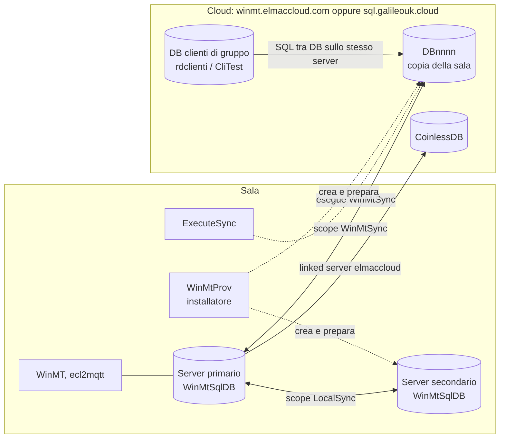

# Galileo HQ — Sync 00: mappa della sincronizzazione sala–cloud (`ExecuteSync`, `WinMtProv`)

**Stato:** bozza · **Responsabile:** Piero · **Aggiornato:** 2026-10-28

**Fonte:** sorgenti ricevuti il 27/10 in `legacy/ExecuteSync/`, `legacy/ExecuteSyncSSH/` e `legacy/WinMtProv/` (esclusi dal repository); DB di test, di produzione e `CliTest` sull'istanza di analisi, in sola lettura · **Collegati:** [`sync-01-executesync.md`](sync-01-executesync.md), [`sync-02-winmtprov.md`](sync-02-winmtprov.md), [`sync-03-script-sql.md`](sync-03-script-sql.md), `docs/ecl2mqtt/ecl2mqtt-00-mappa.md`, `docs/db/db-09-clitest-clienti-multisala.md`

I tre programmi ricevuti sono gli strumenti con cui oggi la sala si sincronizza con il cloud. Questo documento li colloca nell'ecosistema, censisce i loro flussi e raccoglie ciò che serve al modello dati e all'architettura sala–cloud. **V** = verificato nel codice o nei dati, **D** = dedotto.

---

## 1. I tre programmi

| Programma | Cosa è | Tecnologia | Sorgente | Dettaglio |
|---|---|---|---|---|
| **`ExecuteSync`** | Console che esegue **una** sincronizzazione dello scope `WinMtSync` fra il DB di sala e la sua copia nel cloud, poi termina | C#, .NET 4.x, Sync Framework 2.1 | 77 righe, 06/09/2024 | sync 01 |
| **`ExecuteSyncSSH`** | La stessa console, verso il cloud attraverso un tunnel SSH locale (`127.0.0.1:4433`) | C#, .NET 4.6.1 | 76 righe, 24/08/2023 | sync 01 |
| **`WinMtProv`** | *WinMT Provisioning*: strumento dell'installatore per preparare la sincronizzazione, creare il DB cloud della sala e quello del server secondario, sincronizzare a mano e convertire una sala per la multisala | VB.NET Windows Forms, .NET 4.8, Sync Framework 2.1 | 1.150 righe, v1.12, 16/06/2026 | sync 02 |

WinMtProv porta con sé gli **script SQL** per creare i DB di sala, coinless e di gruppo: 176 file, e quelli della sala coincidono con la struttura della produzione (sync 03).

**`ExecuteSync` è il "motore .NET" atteso** (`00-indice.md`, "Materiale atteso")? Esegue la sincronizzazione, ma non la pianifica e non scrive l'esito nel database (§ 2.3). Se esiste un servizio che lo lancia e registra l'esito, quel servizio non è nel materiale ricevuto (§ 7, domanda 1).

## 2. Come funziona oggi la sincronizzazione

### 2.1 Topologia

| Collegamento | Scope | Da / a | Chi lo prepara | Chi lo esegue |
|---|---|---|---|---|
| Sala ↔ cloud | `WinMtSync` | `WinMtSqlDB` del server primario ↔ `DBnnnn` (`DB` + `Setup.NImp` su 4 cifre) sul server cloud | WinMtProv, SY02-02/03/04 | `ExecuteSync` (SY01-01), oppure WinMtProv a mano (SY02-07) |
| Primario ↔ secondario | `LocalSync` | `WinMtSqlDB` del primario ↔ `WinMtSqlDB` del secondario (IP in `Setup(102).NRep3`) | WinMtProv, SY02-05 | Solo WinMtProv a mano (SY02-08) |
| Gruppo ↔ sale | — | Il DB di gruppo legge e scrive i `DBnnnn` delle sale **nel cloud**, con SQL fra database (DB 09) | — | WinMT tramite `CServer`, motore |

**Due ambienti cloud.** WinMtProv propone `winmt.elmaccloud.com` ed `sql.galileouk.cloud`, ciascuno con le proprie credenziali e con una password `sa` delle sale diversa. Il sorgente attuale di `ExecuteSync` punta a `sql.galileouk.cloud`, le build più vecchie a `winmt.elmaccloud.com`. Ci sono quindi almeno due installazioni del cloud, una Elmac e una Galileo UK, con server, utenti e sale separati. **V** sul codice; come si dividono le sale fra i due **non è noto**.

**Il collegamento.** Diretto sulla porta SQL pubblica oppure, dal 2023, attraverso un tunnel SSH su `127.0.0.1:4433`. Il tunnel è la scelta predefinita di WinMtProv, ma nessun programma ricevuto lo apre. **V**

### 2.2 Il meccanismo

- **Microsoft Sync Framework 2.1** (2010), in configurazione *peer-to-peer* fra due SQL Server: ogni scope ha la stessa descrizione sui due lati, le modifiche si tracciano con trigger e tabelle `*_tracking`, e a ogni sessione si scambiano in entrambe le direzioni (`UploadAndDownload`). **V**
- **Perimetro fisso nel codice**: 62 tabelle in WinMtProv 1.12, 61 in produzione, senza filtri. I dati grezzi delle schede (`CoinlessDati`, `CoinlessDecodedData`…), i saldi ECL (`CoinlessCards`) e i log restano in sala (sync 02 § 4). **V**
- **Ogni sala ha la sua copia completa nel cloud.** HQ e il DB di gruppo lavorano sulle copie `DBnnnn`, non sulle sale. **V**
- **I conflitti** si risolvono con il comportamento predefinito di Sync Framework. `ExecuteSync` ne registra solo l'ultimo, in un file (sync 01 § 2). **V**
- **Le cancellazioni si propagano**: una pulizia in sala raggiunge il cloud (DB 04, DB 06). **V**

### 2.3 Dove sta lo stato della sincronizzazione

Lo stato è sparso in tre righe di `Setup` e in un file, con regole diverse per ciascun programma. **V** su codice e dati.

| Dato | Dove lo scrive chi | Dove lo legge chi |
|---|---|---|
| Intervallo, in secondi | WinMtProv: `Setup(101).N0`. WinMT: `Setup(110).N0` | WinMT: `Setup(110).N0`, per l'avviso via email "troppo tempo dall'ultima sincronizzazione" se `D1` è più vecchio di tre intervalli (`Form1.frm:16120-16127`). `sp_last_trans` del DB di gruppo: `Setup(101).N0` della copia cloud, come **intervallo minimo prima che la card possa essere usata in un'altra sala** (DB 09 § 3) |
| Esito ("Success on: …", "Failed on: …") e ora | **Nessun programma ricevuto.** In produzione la riga 110 registra "Success" il 14/07/2026, giorno della copia; la riga 101 è ferma al 04/06/2024 | WinMT colora il bordo del pulsante di chiusura leggendo `SyncRes` della **prima** riga di `Setup`, cioè la 101 (`Form1.frm:16889-16896`). `sp_verifica_syncro` del DB di gruppo legge la 101 di tutte le copie |
| Sincronizzazione abilitata | WinMT: `Setup(101).SyncEn` (W10) | WinMT |
| Statistiche e ultimo conflitto | `ExecuteSync`: `Sync.log` nella sua cartella e nei Documenti | Nessuno |

Valori: in **produzione** `N0` = 600 sia in 101 sia in 110; nel **test** 0 in 101 e 3.600 in 110.

**Cosa ne segue.**

1. **L'indicatore di WinMT in produzione è verde da due anni**, qualunque sia l'esito reale: legge una riga che nessuno aggiorna dal 04/06/2024. L'avviso via email invece usa la riga 110, che è aggiornata. **V** (codice e dati)
2. **Un componente scrive l'esito nella riga 110, ma non è fra quelli ricevuti.** Scrive "Success on: <data>" e `D1`. È probabilmente il programma che pianifica `ExecuteSync` (§ 7, domanda 1). **D**
3. **Una regola di business dipende dalla latenza della sincronizzazione.** Il blocco anti-riuso della card fra sale del gruppo usa l'intervallo di sincronizzazione come finestra: dopo un uso in una sala, la card non vale nelle altre finché i dati non possono essere arrivati. Se l'intervallo cambia in WinMT (riga 110) la regola non se ne accorge, perché legge la 101. **V** sul codice

## 3. Rapporto con WinMT e con il motore `ecl2mqtt`

**Separazione.** I tre programmi non contengono regole di dominio, salvo la conversione multisala (SY02-10), e non duplicano logica di WinMT né del motore. L'integrazione passa, ancora una volta, dal database: `Setup` (righe 101, 102, 110), lo schema e le tabelle dello scope. **V**

| Tema | WinMtProv / ExecuteSync | WinMT | `ecl2mqtt` |
|---|---|---|---|
| Intervallo di sync | `Setup(101).N0` | `Setup(110).N0` | — |
| Esito di sync | Non lo scrive | Lo legge da 101 (indicatore) e 110 (avviso) | — |
| IP del server secondario | Legge `Setup(102).NRep3` | Lo usa come IP del secondario (db-08, `Module1.bas:2680`) | Failover con `SLAVEFIND` e `/redundance` (ecl2mqtt 01) |
| Identificativo di gruppo del cliente | Converte lo storico (`× 10000 + sala`) | Scrive `IdLong` alla creazione del cliente, `F0 = 1` sui movimenti in gruppo | Scrive `TransCard.F0 = 0` sempre (ecl2mqtt 08) |
| Schema del DB | Crea i DB cloud e secondario dagli script | Modifica tabelle e riscrive procedure all'avvio | Crea tabelle e una vista all'avvio |
| Tabelle del motore nel cloud | Le include nel perimetro: `ecl_*`, `BEConfig`, `coinless_sbuilder_*`, `Gru*`, `PrizeHubSlots` | — | Le scrive, senza sapere che sono sincronizzate |

**Risposta alla domanda 6 di ecl2mqtt 00 § 7** ("come si sincronizzano i DB di master e slave"). Il motore non lo fa: lo fa Sync Framework con lo scope `LocalSync`, preparato da WinMtProv. Nel codice ricevuto, però, `LocalSync` si esegue **solo a mano** (SY02-08). La documentazione di Fabrizio parla di "ogni 60 secondi" (ecl2mqtt 00 § 7): se è così, lo fa il componente mancante del § 2.3.

## 4. Catalogo dei flussi

Stessa regola di peso di Analisi 01 (S = 1, M = 3, L = 8), applicata alla funzione da rifare e non alle righe di codice. Il dettaglio dei flussi, con le evidenze, è in sync 01 § 6 e sync 02 § 10.

| Id | Flusso | Peso | Stato | Zona concettuale |
|---|---|:-:|---|---|
| SY01-01 | Sincronizzazione sala–cloud (`WinMtSync`) | L | attivo | Multi-sala e governo remoto |
| SY01-02 | Sincronizzazione via tunnel SSH | — | variante di SY01-01 | |
| SY01-03 | Registrazione dell'esito in file | S | attivo | Piattaforma |
| SY02-01 | Lettura della configurazione di sync | S | attivo | Piattaforma |
| SY02-02 | Provisioning dello scope in sala | M | attivo | Piattaforma |
| SY02-03 | Creazione del DB cloud della sala | M | attivo | Multi-sala e governo remoto |
| SY02-04 | Provisioning dello scope nel cloud | S | attivo | Multi-sala e governo remoto |
| SY02-05 | Preparazione del server secondario (`LocalSync`) | M | attivo | Piattaforma |
| SY02-06 | Deprovisioning | S | attivo | Piattaforma |
| SY02-07 | Sincronizzazione manuale con il cloud | — | duplicato di SY01-01 | |
| SY02-08 | Sincronizzazione con il server secondario | M | attivo | Piattaforma |
| SY02-09 | Intervallo di sincronizzazione | S | attivo, doppione con WinMT (riga diversa) | Piattaforma |
| SY02-10 | Conversione della sala per la multisala | M | attivo | Multi-sala e governo remoto |
| SY02-11 | Allargamento di `Setup.T6/T7` | — | morto | |
| SY02-12 | Creazione della struttura da file `.txt` | — | morto | |

**Riepilogo: 11 flussi attivi** (5 S, 5 M, 1 L), **28 punti**; 1 variante, 1 duplicato, 2 morti. Per zona: Multi-sala e governo remoto 4 flussi (15 punti), Piattaforma 7 flussi (13 punti).

**Lettura.** Sono pochi punti, ma Analisi 01 lo aveva previsto: la multisala "vive soprattutto in HQ, nel sincronizzatore e nello scambio di file". Nel nuovo sistema i flussi di provisioning e di conversione **non si rifanno**: si sostituiscono con un'architettura in cui la sala ha un'identità nel cloud fin dall'installazione e gli identificativi sono globali fin dall'origine. Resta da rifare, ed è la parte più pesante, la funzione di SY01-01: **la replica fra sala e cloud**, con la sala autonoma quando la connessione manca. La sincronizzazione locale fra primario e secondario (SY02-05, SY02-08) è il requisito di continuità del server di sala.

## 5. Cosa aggiunge al modello dati e all'architettura

1. **Il perimetro di sincronizzazione è una decisione di architettura, oggi implicita.** Le 62 tabelle sono scritte nel codice di WinMtProv, senza filtri, e comprendono configurazione (`Setup`, `Setup2`), anagrafiche, movimenti e tabelle tecniche del motore. Nel nuovo sistema va deciso per ogni entità: chi ne è proprietario (sala o cloud), in che direzione viaggia, con quale latenza e come si risolvono i conflitti. La matrice di ecl2mqtt 08 è il punto di partenza.
2. **L'identità del cliente nel gruppo è un identificativo composto**, `IdContatto × 10000 + sala`, calcolato alla creazione e ricalcolato sullo storico quando la sala entra in un gruppo. Nove tabelle hanno un flag che dice "questa riga è in formato di gruppo" (sync 02 § 6). Nel nuovo modello l'identificativo del cliente deve essere globale e stabile fin dalla nascita: niente conversioni dello storico.
3. **Lo stato della sincronizzazione va modellato** (ultima sessione, esito, ritardo, conflitti, per sala e per collegamento), invece di stringhe in `Setup.SyncRes` lette da righe diverse. È anche ciò che serve al cloud per sapere quanto sono aggiornati i dati di ogni sala.
4. **Le regole che dipendono dalla latenza vanno rese esplicite.** Il blocco della card fra sale (§ 2.3, punto 3) oggi usa l'intervallo di sync come approssimazione della consistenza. Con un registro di movimenti centrale e la sala autonoma offline, la regola va riscritta: cosa può fare una card in una sala quando il cloud non è raggiungibile?
5. **Chiavi tecniche di replica.** Le colonne `Keys` `uniqueidentifier` esistono per Sync Framework (sync 03 § 2). Non vanno confuse con gli identificativi di dominio.
6. **Nuovi significati per db-08**: `Tickets.N1`, `TicketsCan.F0`, `TickRep.F0`, `Vincite25.F0`, `Abbuoni.F0` = "riga convertita al formato di gruppo"; `Setup(101).N0` = intervallo di sync per WinMtProv e per il DB di gruppo, distinto da `Setup(110).N0` di WinMT; `Setup(102).NRep3` letto anche da WinMtProv.

## 6. Rischi da conoscere già nell'esercizio attuale

| Rischio | Evidenza | Certezza |
|---|---|---|
| **Credenziali di massimo livello negli eseguibili.** WinMtProv contiene le password `sa` dei due server cloud; `ExecuteSync` quella di `WinMtSync`, `db_owner` di ogni DB cloud; gli script creano un linked server `elmaccloud` come `sa` valido per tutti i login del server di sala | sync 01 § 5, sync 02 § 9, sync 03 § 5 | V |
| **`DROP DATABASE` del DB cloud con due conferme**, a partire da un nome di 6 caratteri digitabile a mano | sync 02 § 3.2 | V |
| **Indicatore di sincronizzazione di WinMT non attendibile** in produzione | § 2.3 | V |
| **Rieseguire la conversione multisala** moltiplica una seconda volta gli identificativi delle righe scritte con il flag a 0: movimenti del motore, abbuoni, lotti dei prelievi multisala | sync 02 § 6 | V sul codice, nessun caso osservato |
| **`Abbuoni.Id` (operatore) convertito come se fosse un cliente** | sync 02 § 6 | V sul codice |
| **Server secondario senza trigger applicativi** dopo la creazione con WinMtProv | sync 03 § 2.1 | D |
| **`LocalSync` senza esecuzione periodica** nel codice ricevuto: il secondario può essere disallineato al momento del failover | § 3 | V sul codice; esercizio reale da verificare |
| **Sync Framework 2.1** è una libreria del 2010 che Microsoft non sviluppa più | sync 01 § 1 | V |
| **Server cloud scritto nel codice**: per cambiare ambiente o percorso si ricompila | sync 01 § 4 | V |

## 7. Domande aperte

1. **Chi lancia `ExecuteSync`, ogni quanto, e chi scrive `Setup(110).SyncRes` e `D1`?** Un'operazione pianificata di Windows, un servizio, il "motore .NET"? Serve il sorgente del componente che manca.
2. **Chi esegue `LocalSync` in esercizio**, e con quale frequenza ("ogni 60 secondi" secondo la documentazione di Fabrizio)?
3. **Chi apre il tunnel SSH** verso il cloud, con quale chiave, e da quando è obbligatorio?
4. **Quali sale stanno su `winmt.elmaccloud.com` e quali su `sql.galileouk.cloud`?** HQ lavora su entrambi?
5. **Le sale di un gruppo sono state convertite con `MULTI SITE SETUP`?** La conversione di `Abbuoni.Id` è voluta?
6. **Il DB di gruppo** si installa ancora dagli script del 2023 (sync 03 § 3)? Dove sta la versione corrente?
7. **I trigger applicativi** come si installano su una sala nuova e sul secondario?
8. Quale intervallo vale davvero, `Setup(101).N0` o `Setup(110).N0`? Le due righe vanno tenute uguali a mano?
9. **Aggiornamento 28/10.** In `CliTest` la tabella `Clienti` è sincronizzata con tre scope `SyncCliNNNN`, uno per sala (DB 09 § 1): chi li prepara e chi li esegue? WinMtProv non li conosce.

## 8. Effetti sui documenti precedenti

| Documento | Cosa cambia |
|---|---|
| DB 03 § 2, DB 04 § 2, DB 06 § 1, traccia della riunione del 19/10 (domanda 2) | **Risposta:** `WinMtSync` sincronizza la sala con la sua copia `DBnnnn` nel cloud; `LocalSync` il server primario con il secondario della sala |
| DB 04 § 1 | La data dell'11/12/2024 in `Setup(101).SyncRes` non indica lo scope: è l'ultimo esito scritto nella riga 101, oggi abbandonata a favore della 110 |
| DB 07 § 4.1 | Confermato: il perimetro è quello di `AddTables` in WinMtProv; le chiavi primarie aggiunte sono negli script di riferimento |
| db-08 | Nuovi significati del § 5, punto 6 |
| ecl2mqtt 00 § 7, domanda 6 | Risposta parziale (§ 3) |
| Analisi 01 § 3 | I flussi della sincronizzazione sono censiti qui (§ 4) |

## 9. Prossimi passi proposti

1. Chiedere a Fabrizio il componente che pianifica la sincronizzazione e scrive l'esito (domanda 1). È l'ultimo pezzo della catena sala–cloud attuale.
2. Su una sala in gruppo: verificare `Setup(101)` e `Setup(110)`, i flag di conversione e il contenuto di `Clienti.N0` (DB 09, domanda 3).
3. Aggiornare db-08 con i significati del § 5 e la matrice di ecl2mqtt 08 con WinMtProv fra gli scrittori.
4. Usare gli script di sync 03 come schema "com'è" di partenza per il piano di migrazione.
